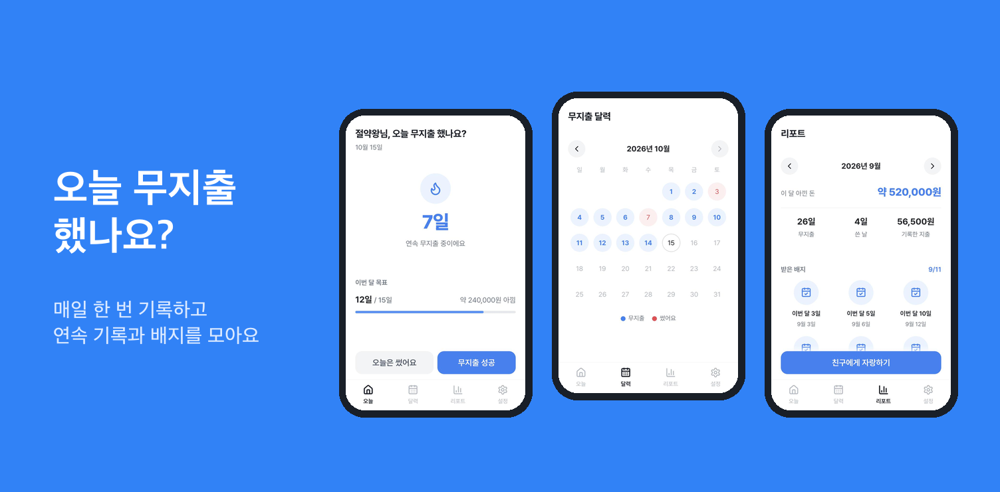
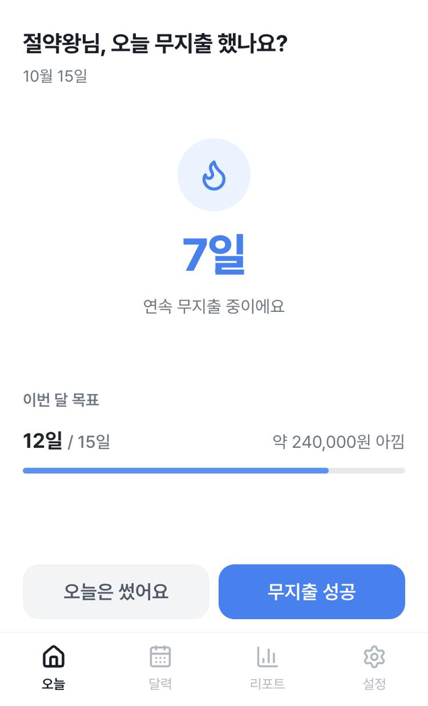
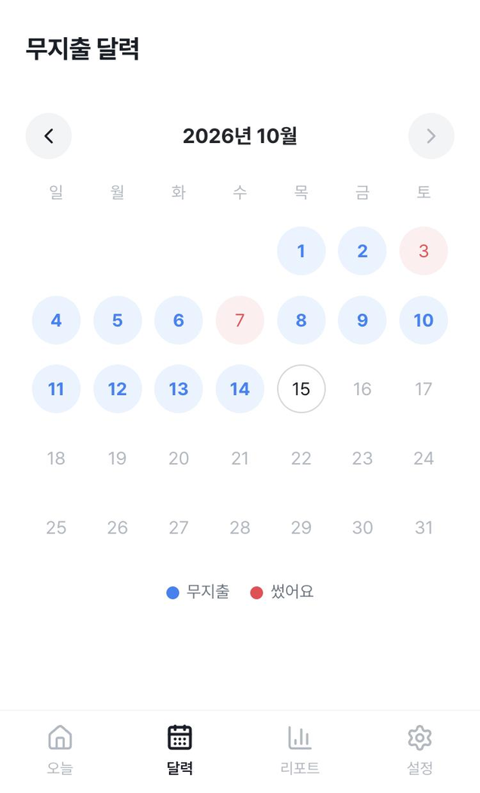
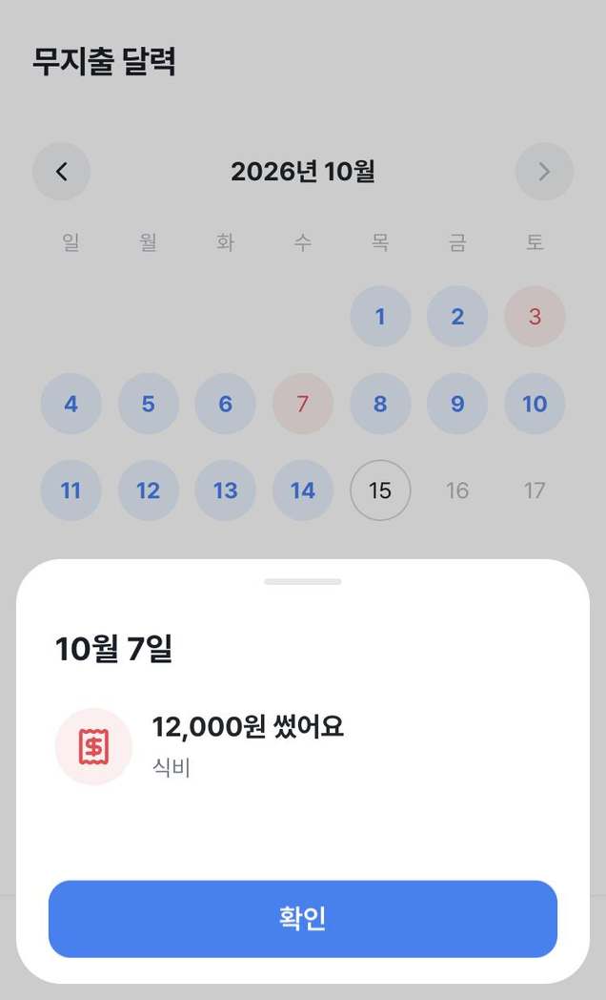
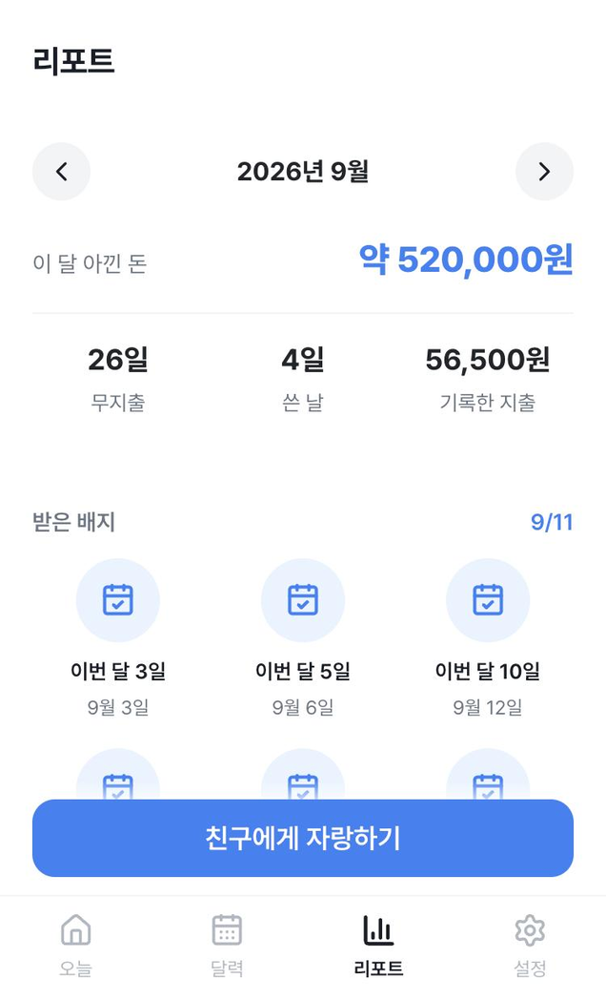
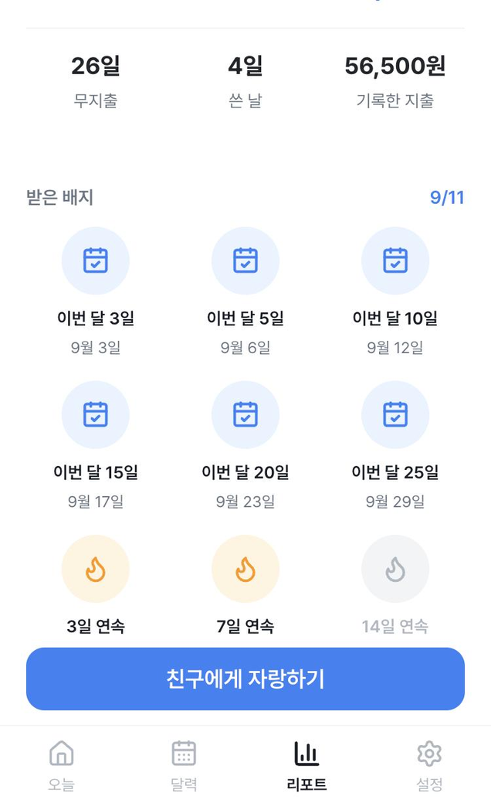

<div align="center">


# 오늘 무지출 했나요?

**매일 한 번, 돈 안 쓴 날을 기록하고 절약 습관을 만들어요.**

토스 앱 안에서 바로 쓰는 무지출 챌린지 미니앱

</div>

<p align="center">
  
</p>

## 이런 앱이에요

오늘 돈을 쓰지 않았다면 버튼 한 번으로 기록하세요.
기록이 쌓일수록 연속 기록이 길어지고, 이번 달 아낀 돈이 눈에 보여요.
매달 새로 시작하는 배지를 모으다 보면 절약이 습관이 돼요.

## 주요 기능

<table>
  <tr>
    <td align="center" width="33%">
      <br />
      <b>오늘 기록</b><br />
      <sub>'무지출 성공' 또는 '오늘은 썼어요'<br />버튼 한 번으로 하루를 기록해요</sub>
    </td>
    <td align="center" width="33%">
      <br />
      <b>무지출 달력</b><br />
      <sub>무지출한 날과 쓴 날을<br />달력에서 한눈에 확인해요</sub>
    </td>
    <td align="center" width="33%">
      <br />
      <b>날짜별 기록</b><br />
      <sub>날짜를 누르면 그날<br />어디에 얼마 썼는지 보여줘요</sub>
    </td>
  </tr>
  <tr>
    <td align="center">
      <br />
      <b>아낀 돈 리포트</b><br />
      <sub>달마다 아낀 돈과 쓴 날을 정리하고<br />친구에게 자랑할 수 있어요</sub>
    </td>
    <td align="center">
      <br />
      <b>월별 배지</b><br />
      <sub>무지출 일수, 연속 기록, 목표 달성으로<br />배지를 모아요. 매달 새로 시작해요</sub>
    </td>
    <td align="center" valign="middle">
      <b>그리고</b><br /><br />
      <sub>
        저녁 9시 기록 알림<br />
        어제 깜빡한 기록 복구<br />
        월 목표와 하루 평균 지출 설정<br />
        로그인 없이 바로 시작
      </sub>
    </td>
  </tr>
</table>

## 이렇게 써요

1. 닉네임(2~4글자)을 정하고 시작해요.
2. 매일 저녁 오늘 돈을 썼는지 기록해요. 쓴 날은 카테고리와 금액을 남길 수 있어요.
3. 연속 기록과 이번 달 목표가 채워지는 걸 확인해요.
4. 배지를 모으고 리포트로 한 달을 돌아봐요.

---

## 개발

토스 [앱인토스](https://developers-apps-in-toss.toss.im/) WebView 미니앱이에요.

| 구분 | 사용 기술 |
|---|---|
| 프레임워크 | React 18, TypeScript, Vite |
| 디자인 | TDS(토스 디자인 시스템), Pretendard, lucide-react |
| 앱인토스 SDK | `@apps-in-toss/web-framework` (Storage, 인앱 광고, 공유, 알림 동의) |
| 데이터 검증 | zod |
| 테스트 | vitest |

### 시작하기

```bash
npm install
npm run dev
```

### 테스트

```bash
npm test
```

### 빌드하고 배포하기

```bash
npm run build
npm run deploy
```

`npm run build`를 하면 콘솔에 올릴 `zero-spend.ait` 파일이 만들어져요.
배포 API 키는 [앱인토스 콘솔](https://apps-in-toss.toss.im/) → 워크스페이스 → API 키에서 발급받아요.

### 출시 전 설정

| 파일 | 할 일 |
|---|---|
| `src/config/ads.ts` | 콘솔에서 발급한 광고 그룹 ID(배너, 전면형, 리워드)로 교체 |
| `src/config/notification.ts` | 푸시 템플릿 검수 후 받은 템플릿 코드 입력 |

### 화면 주소

`intoss://zero-spend/{경로}`로 열면 해당 탭이 바로 열려요.

| 경로 | 화면 |
|---|---|
| (없음) | 오늘 |
| `calendar` | 무지출 달력 |
| `report` | 리포트 |
| `settings` | 설정 |

### 폴더 구조

```text
src/
├── domain/       # 기록, 연속 기록, 배지, 저장 데이터 계산 (테스트 포함)
├── pages/        # 오늘, 달력, 리포트, 설정, 닉네임 화면
├── components/   # 하단 버튼, 네비게이션, 바텀시트, 배지 등
├── hooks/        # 상태 저장, 광고, 날짜
├── platform/     # 앱인토스 SDK 연결 (저장소, 공유, 알림)
├── navigation/   # 주소 경로 ↔ 탭
└── config/       # 광고 ID, 알림 템플릿 코드
assets/
├── icon/         # 앱 아이콘 (콘솔 등록용 600x600)
└── screenshots/  # 콘솔 등록용 스크린샷
```

### 유용한 링크

- [앱인토스 콘솔](https://apps-in-toss.toss.im/)
- [앱인토스 개발자센터](https://developers-apps-in-toss.toss.im/)
- [앱인토스 개발자 커뮤니티](https://techchat-apps-in-toss.toss.im/)
